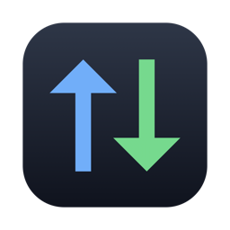
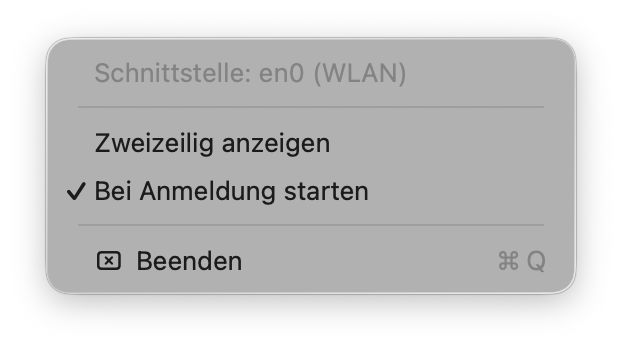

<p align="center"></p>

<h1 align="center">NetSpeed</h1>

<p align="center">
Winzige Mac-App, die die aktuelle Up- und Download-Geschwindigkeit deiner WLAN-Verbindung<br>
direkt in der Menüleiste neben der Uhr anzeigt – modern, farbig, sehr gut lesbar.
</p>

<p align="center"></p>

---

## Funktionen

- **Live-Anzeige** von Download (↓ grün) und Upload (↑ blau), jede Sekunde aktualisiert
- **Einzeilig oder zweizeilig** – per **Rechtsklick** auf die Anzeige umschalten, die Wahl bleibt gespeichert
- **Feste Breite** – die Menüleiste springt nicht, wenn sich die Zahlen ändern
- **Dezente Kapsel** als Hintergrund, damit die Werte auf jedem Hintergrundbild lesbar bleiben; passt sich hellem und dunklem Modus an
- **Platz direkt neben Kontrollzentrum und Uhr** ab dem ersten Start – auf Macs mit Notch verschwindet die Anzeige nicht dahinter
- **Autostart** bei der Anmeldung, im Menü ein- und ausschaltbar
- Erkennt die WLAN-Schnittstelle automatisch (meist `en0`)
- Einheit **Bit pro Sekunde** (kb/s, Mb/s, Gb/s) – wie bei Speedtests und Internettarifen
- Universal-App für **Apple Silicon und Intel**, ab **macOS 13**, keine Abhängigkeiten, ~300 KB

## Screenshots

| Einzeilig | Zweizeilig |
| --- | --- |
|  |  |

**Menü** (Linksklick auf die Anzeige):



## Installation

1. Unter [**Releases**](../../releases/latest) die Datei `NetSpeed.zip` herunterladen und entpacken.
2. `NetSpeed.app` in den Ordner **Programme** ziehen und öffnen.
3. Die App ist nicht bei Apple beglaubigt. Beim ersten Öffnen erscheint deshalb „kann nicht überprüft werden“ –
   dann unter **Systemeinstellungen → Datenschutz & Sicherheit** auf **„Trotzdem öffnen“** klicken. Nur einmal nötig.

## Bedienung

| Aktion | Wirkung |
| --- | --- |
| **Linksklick** | Menü: Schnittstelle, Zweizeilig anzeigen, Bei Anmeldung starten, Beenden |
| **Rechtsklick** | zwischen ein- und zweizeiliger Anzeige umschalten |
| **⌘ + Ziehen** | Anzeige an eine andere Stelle der Menüleiste verschieben |

> Kontrollzentrum und Uhr hält macOS fest ganz rechts – näher als direkt links daneben kann keine App rücken.

## Selbst bauen

Nur die Xcode-Kommandozeilenwerkzeuge sind nötig (`xcode-select --install`), kein Xcode-Projekt.

```bash
git clone https://github.com/openkairo/netspeed-menubar.git
cd netspeed-menubar
./build.sh
```

`build.sh` baut die Universal-App (arm64 + x86_64), erzeugt das Symbol, signiert ad hoc, packt `dist/NetSpeed.zip`
und installiert die App nach `/Applications`.

| Datei | Inhalt |
| --- | --- |
| `NetSpeed.swift` | die komplette App (AppKit, ~200 Zeilen) |
| `icon.swift` | zeichnet das App-Symbol |
| `build.sh` | Bauen, Verpacken, Installieren |

## Wie es misst

NetSpeed liest jede Sekunde die Byte-Zähler der WLAN-Schnittstelle über `getifaddrs()` und rechnet die Differenz
in eine Rate um. Die 32-Bit-Zähler des Systems laufen alle 4 GB über; das wird abgefangen. Gemessen wird der
gesamte Verkehr über das WLAN – auch Kopien im Heimnetz, nicht nur die Internetverbindung.
Keine Netzwerkverbindungen nach außen, keine Daten werden gesammelt.

## Lizenz

[MIT](LICENSE)
